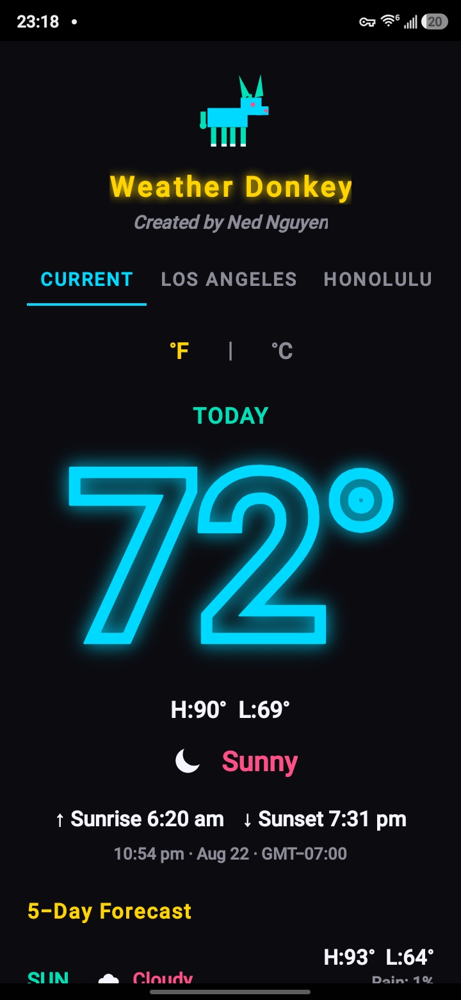
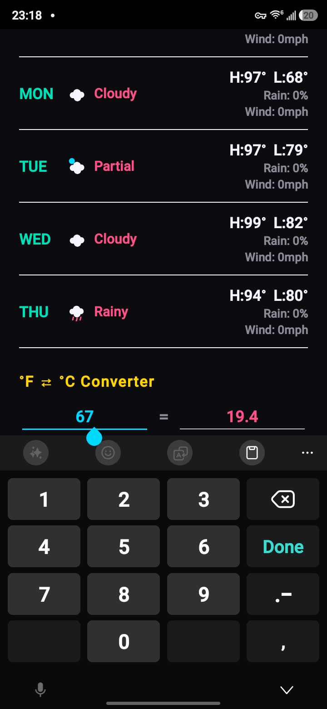

# Weather Donkey Hub

Weather Donkey, now with its own home server. The Android app and home-screen
widget look and work the same as before, but they no longer talk to a weather
service themselves. Everything goes through a small server on the home network
that:

- **Pulls from three free, keyless, worldwide sources** —
  [Open-Meteo](https://open-meteo.com), [MET Norway](https://api.met.no) and
  [7Timer!](https://www.7timer.info) (built on NOAA's global model) — all at once,
  and **shows their average by default**: temperatures, wind and details are
  averaged, rain chance is averaged over the sources that have one, and the
  condition is whatever most sources agree on. Tap **Open-Meteo**, **MET Norway**
  or **7Timer!** (on the web page or in the app) to see that source's own version
  instead; the choice is remembered, and the widget follows the app's choice.
  A source that's down is skipped with a small yellow note such as
  *"Open-Meteo unavailable — averaging MET Norway & 7Timer!"*. A stuck connection
  is dropped after 4 s and retried twice (Open-Meteo: after 2.5 s, retried four
  times, because its server sometimes stalls mid-handshake). If a source still
  fails, its last good answer for that place (up to 3 hours old, trimmed to the
  hours still ahead) is shown instead, so a short blip doesn't show the note at all;
  it's never recorded. After any fetch where a source failed (scheduled or ↻ Refresh /
  pull-down), that place is quietly retried after 2, 5 and 10 minutes, so the note
  clears by itself once the source is back and Home's recording isn't lost. A request fails
  only if all three are down and nothing recent is saved.
- **Server refreshes every 3 hours on the clock (12, 3, 6, 9).** Opening the web page
  never fetches; it shows the latest scheduled snapshot. ↻ Refresh fetches right away without
  moving the schedule. While it works, the ↻ spins, a bar slides under the Right Now
  header, the numbers dim and the status line says what's happening; it ends with
  *"Updated just now ✓"*. The phone has no timer: it refreshes only on pull-down in the app
  (which asks: weather sources or weather server) or the widget's big ↻ (server's latest).
- **Records the weather for its own location only.** Home is where
  this computer is, and it's recorded from every source that answers into a local SQLite
  database. Saved cities and the phone's **Current** (GPS) tab show live
  weather but are **never recorded**, wherever you are.
- **Keeps 10 years of recordings**, then deletes anything older automatically.
- **Answers "What was the weather?"** for any date (and optionally a time). It
  uses its own recordings first. For dates it never recorded, it falls back to
  Open-Meteo's historical archive, which goes back to 1940, and the answer says
  which source it came from.

```
phone (app + widget)  ──home Wi‑Fi──▶  Weather Donkey Hub :8094  ──▶  Open-Meteo  ┐
                                       (Mint box, SQLite)         ├─▶  MET Norway  ├ averaged
                                                                  ├─▶  7Timer!     ┘
                                                                  ├─▶  Open-Meteo archive
                                                                  └─▶  Wikipedia (On This Day, yearly)
```

- **Has its own web page** at http://192.168.1.5:8094: a pure-black (AMOLED)
  dashboard with current conditions (8 compact detail boxes sized like the app's: feels-like,
  humidity, wind direction and gusts, pressure, cloud cover, UV; a daylight bar; and the moon: tonight's phase and
  % lit plus the dates of the next new, first-quarter, full and last-quarter moons), the 12-hour and 5-day
  forecasts, *What Was the Weather?*, **On This Day** (events, famous births and
  deaths, and holidays — downloaded from Wikipedia once a year and served from
  the server), the °F ⇄ °C converter (with the math worked out for your number,
  both formulas, and tricks for converting in your head), and location management. You can save a city by name or US ZIP code to view it, remove a
  city, or move Home if the server moves.
  On a narrow window the city tabs wrap onto extra rows (and scroll up/down if
  there are many), and every scrollbar on the page is big (20px) and orange. The sideways bar under Next 12 Hours
  is drawn by the page itself so it never fades away; up/down bars may fade.
- **Keeps the app and the web page in sync.** Cities added or removed on either
  one carry over to the other on the app's next pull-to-refresh.
- **Finds history for any spot.** Lookups within 10 km of Home use the
  server's own recordings. Anywhere else, including saved cities and wherever
  your phone is, they use the archive.

The server listens on the home network only. The app and widget read
everything from it, on home Wi‑Fi or away from home through a VPN into the
home network. With no route home, they keep showing the last weather they
loaded, with *"Server unreachable"*.

## Home-screen widgets

Two widgets, both listed under **Weather Donkey** in the widget picker. Each asks which location to show when you add it (Current or a saved city), follows the app's °F/°C and source choice, and has no timer.

- **Weather Donkey** (2×2): city, current temperature with today's high/low, the condition, sunrise/sunset, and the next two days.
- **Weather Donkey Wide** (4×2, resizable), same black card with a teal border:
    - **Top:** the city name, centered, the same distance below the border as the System Monitor widget's title (8dp top padding).
    - **Middle:** the current temperature (big, cyan) beside the condition (yellow) and today's high/low, centered left of a thin bright-teal divider; right of it, **Feels**, **Rain**, **Wind** (speed and direction) and **Humidity**, in a 144dp column set 12dp in from the right edge so there's a clear gap between each label and its value.
    - **Bottom:** sunrise ↑ and sunset ↓ stacked at the start of the row, then a divider, then the next 5 days, each the day name over its high (white) over its low (dimmed), grouped a little closer together (14dp padding each side of the group).
    - **Divider lines** (beside the stats, above the 5 days, beside sunrise/sunset) are bright teal (80%), matching the Today + Calendar widget's divider.
    - Text sizes are shared with the Today + Calendar widget: temperature 60sp = its day number, city 14sp = its weekday.
    - **Top-left:** a big cyan **↻** (fingertip-sized tap area), level with the city name.
    - **Footer:** **Server update** and the time the server last got this weather.
    - No icons or rain chances on this one. It's a quick temperature glance, and the app has the details.
    - **Resizable** (long-press → drag the handles), down to 3 columns × 1 row. Smaller sizes drop whole sections instead of squeezing them (sizes on the phone's 5-column grid):
        - **5 columns:** everything.
        - **4 columns:** no Feels / Rain / Wind / Humidity column; the temperature group stays centered.
        - **3 columns:** also no sunrise/sunset, only 4 forecast days, slightly smaller temperature.
        - **1 row tall:** just the city, ↻ and the temperature row (no forecast or status line).
      `buildWideViews()` reads the widget's size (`OPTION_APPWIDGET_MIN_WIDTH/HEIGHT`; One UI reports ~91dp per column, ~116dp per row) and redraws on every resize.

Both widgets:

- **Refreshing:** tap the big cyan **↻** at the top-left. It loads the **server's latest update** for that widget's location (it doesn't make the server pull new weather from the sources; pull down in the app for that). While it works the ↻ turns yellow and the bottom line reads **Updating from server…** in cyan, for at least 1.2 s so you can see it happen.
- **Bottom line:** **Server update 15:00 · Nov 18 · PST**, the time the server last got that weather from the sources, plus a note if it had to use a backup source. It isn't tappable.
- **Tapping anywhere else** opens the app.
- **Forecast days that have already passed are skipped.** The forecast is stored from the day after it was fetched, so with an old cache (phone away from home with no VPN) the 5-day row starts at the next day still ahead and leaves the rest blank, instead of showing past days. A refresh on the home network fills it again.
- **Repaint after an app update.** The launcher shows a widget's bare `--` layout after the app is reinstalled, so the app repaints every widget from cache as soon as it's updated (`MY_PACKAGE_REPLACED`).

The wide widget is `WeatherWideWidgetProvider`, a subclass of `WeatherWidgetProvider`, so it shares all the fetch, cache, location and tap code; `buildViews()` draws `widget_weather_wide.xml` when the widget id belongs to it.

## Screenshots

<p>
  
  
  
</p>

## Layout

```
server/
  server.py                   — the whole server: stdlib Python only, nothing to pip install
  web/index.html              — the web page the server shows at /
  weather-donkey-hub.service  — systemd user unit
android/                      — the app + widget (installs over the original Weather Donkey)
```

## Server

```sh
python3 server/server.py        # serves on 0.0.0.0:8094, data in server/data/weather.db
```

Environment overrides: `WEATHER_DONKEY_PORT`, `WEATHER_DONKEY_DATA`.

As a service that starts at boot (user services need `loginctl enable-linger`):

```sh
mkdir -p ~/WeatherDonkeyHub && cp -r server/server.py server/web ~/WeatherDonkeyHub/
cp server/weather-donkey-hub.service ~/.config/systemd/user/
systemctl --user daemon-reload && systemctl --user enable --now weather-donkey-hub
sudo ufw allow from 192.168.1.0/24 to any port 8094 proto tcp
```

### API

| Call | What it does |
|---|---|
| `GET /api/weather?id=&name=&lat=&lon=` | Fresh weather from all three sources, in the app's snapshot format (plus `notice`, `sources` and `details`). Recorded only for `id=home`. 503 only if **all three** are down. |
| `GET /api/history?id=&lat=&lon=&date=YYYY-MM-DD[&time=HH:MM]` | That day's high/low/condition/wind/sunrise/sunset, plus that hour's reading if a time is given. `source` is `recorded` or `archive`. |
| `GET /api/locations[?all=1]` | Home and saved cities (`all=1` also lists removed ones). |
| `GET /api/search?q=` | Find a city by name or US ZIP code (Open-Meteo geocoding, Zippopotam.us). |
| `POST /api/locations?name=&lat=&lon=` | Save a city (a tab on the app and web page; not recorded). |
| `POST /api/home?name=&lat=&lon=` | Move the server's Home location. |
| `DELETE /api/locations?id=` | Remove a saved city (removing a tab in the app does this). Home can't be removed. |
| `GET /api/health` | Liveness check. |

### What's stored

Only Home is stored.

- `observations`: one row per source, per hour (temperature,
  WMO weather code, day/night, wind, rain chance). Refreshing again within the
  same hour overwrites that hour's row.
- `daily`: one row per source, per day (high/low, condition,
  wind, rain chance, sunrise/sunset). It's updated every 3 hours, so it ends up as
  that day's summary.
- Anything older than 10 years is deleted every night at midnight.

MET Norway and 7Timer! are converted to Open-Meteo's terms (°F, mph, WMO weather
codes). Neither has a rain-chance percentage (MET Norway only has one in the
Nordic countries), so while one of them is the main source, rain chance shows as
`--%`. 7Timer! comes in 3-hour steps, and the 12-hour strip fills the hours in
between. When Open-Meteo is down, the server calculates sunrise and sunset
itself.

## App

```sh
cd android
export JAVA_HOME=<path to a JDK 17>
./gradlew installDebug
```

The server address is `SERVER_URL` in `android/app/build.gradle.kts`. Plain
HTTP is allowed only to that one address (`res/xml/network_security_config.xml`).

The app screen uses the same card layout as the web page (pure black, teal-bordered
cards): a one-line header with °F | °C, the location tabs, a **Right Now** card with
source chips (Average · Open-Meteo · MET Norway · 7Timer!, each with its temperature),
the outlined temperature beside the condition, an 8-box details grid, a sunrise/sunset
bar and the moon (tonight's phase and % lit, then the next four main phases with dates), then **Next 12 Hours**, **5-Day Forecast** (with range bars), **What Was the
Weather?** and the converter. Tapping a source chip switches the app (and the widget)
to that source's own forecast; Average is the default. It keeps everything the original
had: location tabs, pull-to-refresh, the outlined temperature, °F/°C and per-widget locations. One pull-to-refresh now updates **every tab at once**
(in parallel, all through the server), sideways swipes never trigger a refresh,
and tabs slide in when you swipe between them. The server's Home isn't shown as
an app tab, since it would duplicate Current. It adds a **What Was the Weather?** section: pick a
date and either a time or "Whole day", tap **Look Up**, and it shows the answer
for whichever tab is open.

There's no background timer on the phone, and opening the app doesn't refresh.
Weather refreshes only when you pull down in the app, or tap the big **↻** at the widget's top-left (tapping the rest
of the widget opens the app). Pulling down opens an **Update from…** popup (black, neon pink border) with two buttons:
**Weather sources** (the server pulls new weather from Open-Meteo, MET Norway & 7Timer! right now) or
**Weather server** (load the server's latest saved update, fast); Cancel does nothing. While it works, a cyan bar under
the tabs says what it's doing and from where (*"Server is getting new weather from the sources…"* or
*"Loading the latest update from the server…"*), then where the weather came from for 4 s:
*"✓ New weather from Open-Meteo, MET Norway & 7Timer! (via server)"* or
*"✓ Loaded the server's update from 15:00 · Nov 18 · PST"* (or the error). The line under the weather reads
**Server update &lt;time&gt;**. Tap the donkey or the title for the city list:
tap to switch; long-press for sort mode (drag a city from anywhere on its row, ✕ on the right to remove
with a confirm; ✓ saves the order, ✕ at the top cancels).

## Moon phase

The moon section (app and web page) is calculated on the device itself, so it
needs no server or internet and is always current, even from cached weather. It
uses Jean Meeus' *Astronomical Algorithms* (ch. 48–49): phase times are good to a
minute or two, and "% lit" comes from the Sun–Moon angle. A main phase (New, First
Quarter, Full, Last Quarter) is named on the calendar day it happens; other days
are Waxing/Waning Crescent or Gibbous. Full moons get their traditional name
(Wolf, Snow, Worm, Pink, Flower, Strawberry, Buck, Sturgeon, Harvest, Hunter's,
Beaver, Cold), or *Blue Moon* for a second full moon in a month. On wide web
windows, the night-sky scene beside the temperature shows the real phase.
