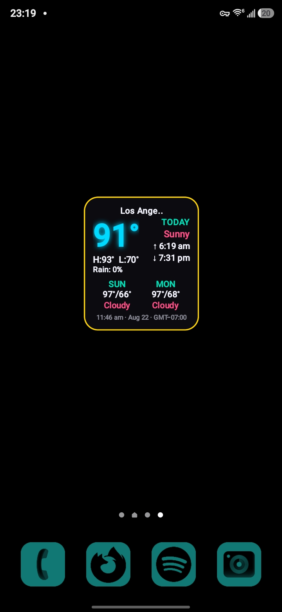

# Weather Donkey Hub

Weather Donkey, now with its own home server. The Android app and home-screen
widget look and work the same as before, but they no longer talk to a weather
service themselves. Everything goes through a small server on the home network
that:

- **Pulls from two free, open sources.** [Open-Meteo](https://open-meteo.com) is
  the main one and [MET Norway](https://api.met.no) is the backup. If one is down,
  the other is used on its own and the app shows a small yellow note such as
  *"Open-Meteo unavailable — showing MET Norway only"*. The widget's status line
  shortens it to *"· MET Norway only"*.
- **Records the weather every hour for its own location only.** Home is where
  this computer is, and it's recorded from both sources into a local SQLite
  database. Saved cities and the phone's **Current** (GPS) tab show live
  weather but are **never recorded**, wherever you are.
- **Keeps 10 years of recordings**, then deletes anything older automatically.
- **Answers "What was the weather?"** for any date (and optionally a time). It
  uses its own recordings first. For dates it never recorded, it falls back to
  Open-Meteo's historical archive, which goes back to 1940, and the answer says
  which source it came from.

```
phone (app + widget)  ──home Wi‑Fi──▶  Weather Donkey Hub :8094  ──▶  Open-Meteo
                                       (Mint box, SQLite)         └─▶  MET Norway
                                                                  └─▶  Open-Meteo archive
```

- **Has its own web page** at http://192.168.1.5:8094: a dashboard in the app's
  style with current conditions (feels-like, humidity, wind direction and gusts,
  pressure, cloud cover, UV, and a daylight bar), the 12-hour and 5-day
  forecasts, *What Was the Weather?*, the °F ⇄ °C converter, and location
  management. You can save a city by name or US ZIP code to view it, remove a
  city, or move Home if the server moves.
- **Keeps the app and the web page in sync.** Cities added or removed on either
  one carry over to the other on the app's next pull-to-refresh.
- **Finds history for any spot.** Lookups within 10 km of Home use the
  server's own recordings. Anywhere else, including saved cities and wherever
  your phone is, they use the archive.

The server is home-network only. Away from home Wi‑Fi, the app and widget keep
showing the last weather they loaded, with *"Can't reach Weather Donkey server
(home Wi‑Fi only)"*.

## Screenshots

<p>
  
  
  
</p>

## Layout

```
server/
  server.py                   — the whole server: stdlib Python only, nothing to pip install
  web/index.html              — the web page the server shows at /
  weather-donkey-hub.service  — systemd user unit
android/                      — the app + widget (installs over the original Weather Donkey)
```

## Server

```sh
python3 server/server.py        # serves on 0.0.0.0:8094, data in server/data/weather.db
```

Environment overrides: `WEATHER_DONKEY_PORT`, `WEATHER_DONKEY_DATA`.

As a service that starts at boot (user services need `loginctl enable-linger`):

```sh
mkdir -p ~/WeatherDonkeyHub && cp -r server/server.py server/web ~/WeatherDonkeyHub/
cp server/weather-donkey-hub.service ~/.config/systemd/user/
systemctl --user daemon-reload && systemctl --user enable --now weather-donkey-hub
sudo ufw allow from 192.168.1.0/24 to any port 8094 proto tcp
```

### API

| Call | What it does |
|---|---|
| `GET /api/weather?id=&name=&lat=&lon=` | Fresh weather from both sources, in the app's snapshot format (plus `notice`, `sources` and `details`). Recorded only for `id=home`. 503 only if **both** sources are down. |
| `GET /api/history?id=&lat=&lon=&date=YYYY-MM-DD[&time=HH:MM]` | That day's high/low/condition/wind/sunrise/sunset, plus that hour's reading if a time is given. `source` is `recorded` or `archive`. |
| `GET /api/locations[?all=1]` | Home and saved cities (`all=1` also lists removed ones). |
| `GET /api/search?q=` | Find a city by name or US ZIP code (Open-Meteo geocoding, Zippopotam.us). |
| `POST /api/locations?name=&lat=&lon=` | Save a city (a tab on the app and web page; not recorded). |
| `POST /api/home?name=&lat=&lon=` | Move the server's Home location. |
| `DELETE /api/locations?id=` | Remove a saved city (removing a tab in the app does this). Home can't be removed. |
| `GET /api/health` | Liveness check. |

### What's stored

Only Home is stored.

- `observations`: one row per source, per hour (temperature,
  WMO weather code, day/night, wind, rain chance). Refreshing again within the
  same hour overwrites that hour's row.
- `daily`: one row per source, per day (high/low, condition,
  wind, rain chance, sunrise/sunset). It's updated every hour, so it ends up as
  that day's summary.
- Anything older than 10 years is deleted every night at 03:02.

MET Norway's data is converted to Open-Meteo's terms (°F, mph, WMO codes).
MET Norway has no rain-chance percentage outside the Nordic countries, so while
it's the only source, rain chance shows as `--%`. Sunrise and sunset are
calculated on the server when MET Norway is the only source.

## App

```sh
cd android
export JAVA_HOME=<path to a JDK 17>
./gradlew installDebug
```

The server address is `SERVER_URL` in `android/app/build.gradle.kts`. Plain
HTTP is allowed only to that one address (`res/xml/network_security_config.xml`).

The app keeps everything the original had: location tabs, pull-to-refresh, the
outlined temperature, °F/°C, the 12-hour strip, the 5-day forecast, the converter
and per-widget locations. It adds a **What Was the Weather?** section: pick a
date and either a time or "Whole day", tap **Look Up**, and it shows the answer
for whichever tab is open.

Like the original, it never refreshes in the background. Weather only loads
when you pull down in the app or tap the widget. The server does the hourly
recording on its own.
